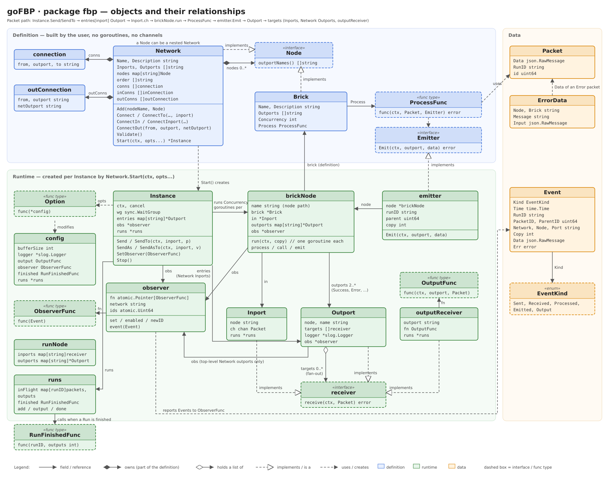

# Package fbp: objects and their relationships

The diagram shows the types of `pkg/fbp` in three areas. Terms follow
[GLOSSARY.md](GLOSSARY.md); see [concept.md](concept.md) for the overall design.

## Definition (blue)

Built by the user. These types hold no goroutines and no channels, so one definition can be used as
several Nodes and in several Instances.

- `Network` holds its Nodes (`nodes map[string]Node`) and its Connections: `conns` between Nodes
  (each to a named Inport of the target, `In` for a Brick), `inConns` from the Network's Inports
  (`In` plus `Inports`) and `outConns` to the Network's Outports.
- `Brick` and `Network` both implement `Node`. This is what allows a Network to contain nested
  Networks.
- `Brick` holds its business logic as a `ProcessFunc`, which receives a `Packet` and an `Emitter`
  for sending results.

## Runtime (green)

Created per Instance by `Network.Start(ctx, opts...)`. Each `Option` changes the internal `config`
(buffer size, logger, `OutputFunc`, `ObserverFunc`, `RunFinishedFunc`).

- `Instance` is one running copy of a Network. It holds one `entries` Outport per Network Inport
  (`Send` uses `In`, `SendTo` any of them) and the shared `observer`, and runs `Concurrency` goroutines per `brickNode`.
- `brickNode` is the runtime state of one Brick Node: it refers to its `Brick` definition, owns one
  `Inport` and the `Outport`s Success, Error and any additional ones.
- `emitter` implements `Emitter` and is handed to the `ProcessFunc`; it sends through the Outports
  of its `brickNode`.
- `Inport`, `Outport` and `outputReceiver` all implement `receiver`. An `Outport` holds a list of
  `targets` and sends each Packet to every one of them (Fan-out). A target can be an `Inport`,
  an Outport of the enclosing Network or, for the top-level Network, an `outputReceiver` that calls
  the `OutputFunc`.
- `runNode` is only used while `Network.build` wires the ports: it is the common view of a Brick
  Node or a nested Network (its Inports by name, which Outports Packets leave through). A Brick has
  only the Inport `In`.
- `runs` exists only with `WithRunFinished`. It counts per Run ID the Packets that are buffered in an
  `Inport` or being processed: `Inport.receive` adds one before the Packet enters the channel,
  `brickNode.run` removes it after `process`, and `Send` holds one while the Network Inport fans out.
  A Brick emits before its own Packet stops counting, so the count never drops to 0 while the Run
  goes on. At 0 it calls the `RunFinishedFunc` with the number of Outputs it counted in
  `outputReceiver`. Packets lost on `Stop` leave their Run unfinished.
- `observer` reports `Event`s to the `ObserverFunc`. It is referenced by the `Instance`, every
  `brickNode` and the Outports of the top-level Network.

## Data (orange)

- `Packet` is the unit of data travelling along a Connection (`Data`, `RunID`, internal Packet ID).
- `ErrorData` is the payload of a Packet sent through the Error Outport when a `ProcessFunc` fails
  or panics.
- `Event` describes one step of a Packet through an Instance; its `EventKind` is one of `Sent`,
  `Received`, `Processed`, `Emitted` or `Output`.

## Path of a Packet

`Instance.Send`/`SendTo` → `entries[inport]` Outport → `Inport.ch` → `brickNode.run` → `ProcessFunc` →
`emitter.Emit` → `Outport` → `targets` (Inports, Network Outports, `outputReceiver`).
