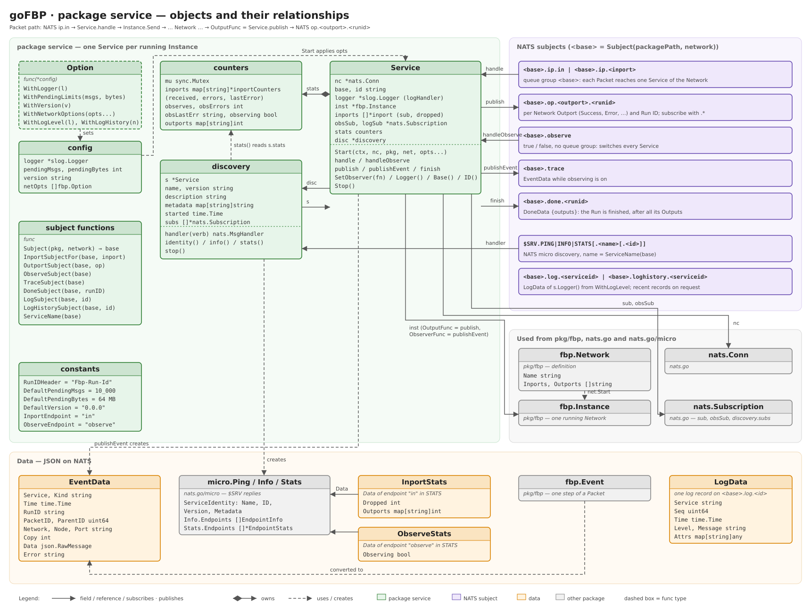

# Package service: objects and their relationships

The diagram shows the types of `pkg/service`, the NATS subjects a Service uses and the types it
uses from other packages. Terms follow [GLOSSARY.md](GLOSSARY.md); see [concept.md](concept.md)
for the overall design, [service.md](service.md) for how a Service behaves and
[fbp-package.md](fbp-package.md) for the Network side.

## Package service (green)

- `Service` wraps exactly one `fbp.Instance` and connects it to NATS. `Start(ctx, nc, pkg, net,
  opts...)` computes the base subject, starts the Instance with `fbp.WithOutput(s.publish)`,
  subscribes to one subject per Network Inport and to the Observe subject and starts the
  discovery. `id` is a random ID per
  Service; it is reported on `$SRV` and as `EventData.Service` (`s.ID()`).
- `Option` is a `func(*config)`; `Start` applies all of them to a `config` with the defaults
  (`slog.Default()`, `DefaultPendingMsgs`, `DefaultPendingBytes`, `DefaultVersion`,
  `slog.LevelInfo`, `DefaultLogHistory`).
  `WithNetworkOptions` passes options on to `fbp.Network.Start`.
- `counters` holds the statistics for `$SRV.STATS`, with `inportCounters` per Network Inport. It is owned by the Service and guarded by a
  mutex, because `handle`, `handleObserve`, `publish` and the STATS responder run in different
  goroutines.
- `logHandler` is the `slog.Handler` of `s.Logger()` (and of the Instance): it wraps the handler
  of the logger from `WithLogger` and hands records at or above `WithLogLevel` to the shared
  `logSink`, which numbers them, keeps the last `WithLogHistory` of them, publishes them on the
  Log subject and answers Log history requests (`s.logSub`). See [service.md](service.md#logs).
- `discovery` answers the NATS micro requests `$SRV.PING`, `$SRV.INFO` and `$SRV.STATS` for its
  Service. It refers back to the Service (`s`) for the base subject, the ID, the counters and
  `Dropped()` of each Inport subscription, and holds its own control subscriptions (`subs`). It does not use
  `micro.AddService`, see [service.md](service.md#discovery-srv).
- `Call(ctx, nc, base, data)` is the client side: it creates the Run ID, subscribes to
  `<base>.op.*.<runid>`, flushes, publishes on `<base>.ip.in` and returns the first Packet of the
  Run with its Outport name. `CallAll(ctx, nc, base, data, fn)` also subscribes to
  `<base>.done.<runid>` and calls `fn` for every Packet until the Run is finished. `CallTo` and
  `CallAllTo` take the name of the Network Inport and publish on its subject. See
  [service.md](service.md#calling-a-service).
- The subject functions build all subjects from the base subject. `ServiceName` turns the base
  subject into a valid micro service name (`.` and other characters become `_`, plus a short
  SHA-256 hash of the base subject to keep names unique).

## NATS subjects (purple)

| Subject | Direction | Handled by |
|---------|-----------|------------|
| `<base>.ip.in` | in, queue group `<base>` | `handle` → `Instance.SendTo(fbp.In)` |
| `<base>.ip.<inport>` | in, queue group `<base>`, one per extra Network Inport | `handle` → `Instance.SendTo(inport)` |
| `<base>.op.<outport>.<runid>` | out | `publish`, the `fbp.OutputFunc` of the Instance |
| `<base>.observe` | in, every Service | `handleObserve` → `Instance.SetObserver` |
| `<base>.trace` | out | `publishEvent`, the `fbp.ObserverFunc` while observing is on |
| `<base>.log.<serviceid>` | out | `logHandler`, the handler of `s.Logger()`, for records at or above `WithLogLevel` |
| `<base>.loghistory.<serviceid>` | in, request/reply | `logSink.handleHistory`: the recent log records |
| `<base>.done.<runid>` | out | `finish`, the `fbp.RunFinishedFunc` of the Instance; also after `reject` (never for a Run going on: `reject` then uses a new Run ID) |
| `$SRV.PING\|INFO\|STATS[.<name>[.<id>]]` | in, request/reply | `discovery.handler` |

`<base>` is `Subject(packagePath, network)`, e.g. `fbp.gofbp.examples.text.pipeline`. Package paths
containing `_` are rejected, so the mapping `.` -> `_` stays unambiguous. `<runid>` is the Packet's
Run ID; subscribe to `<base>.op.<outport>.*` (`OutportSubject(base, outport, "*")`) for all Runs.

## Other packages (grey)

- `fbp.Network` is the definition passed to `Start`; its `Name`, `Inports` and `Outports` become
  part of the subjects and of the `$SRV` metadata. `net.Start` creates the `fbp.Instance`.
- `nats.Conn` is passed in by the caller and is not closed by `Stop`. `nats.Subscription`s are held
  per Network Inport (`inports[i].sub`, each with the pending limits), for Observe (`obsSub`) and in `discovery.subs`.
- `micro.Ping`, `micro.Info` and `micro.Stats` from `nats.go/micro` are only used as reply types,
  so the replies match what `nats micro ls/info/stats` expects.

## Data (orange)

- `EventData` is the JSON form of an `fbp.Event`, published on the Trace subject. Packet IDs are
  counted per Instance, so they are only unique together with `Service`.
- `InportStats` is the `data` of each Inport endpoint in `$SRV.STATS`: messages dropped by the
  pending limits; the endpoint `in` also carries the Packets published per Outport.
- `LogData` is the JSON form of a log record on the Log subject; `Seq` counts per Service, so the
  Log history and the Log subject can be joined without duplicates.
- `ObserveStats` is the `data` of the `observe` endpoint in `$SRV.STATS`: whether observing is on,
  i.e. Events are published on the Trace subject (`counters.observing`).

## Path of a Packet

NATS `<base>.ip.in` or `<base>.ip.<inport>` → `Service.handle` (Run ID from `Fbp-Run-Id`, subject token and length check, JSON
check) → `Instance.SendTo` → Network → `Service.publish` → NATS `<base>.op.<outport>.<runid>` with the
Run ID also in the header.
